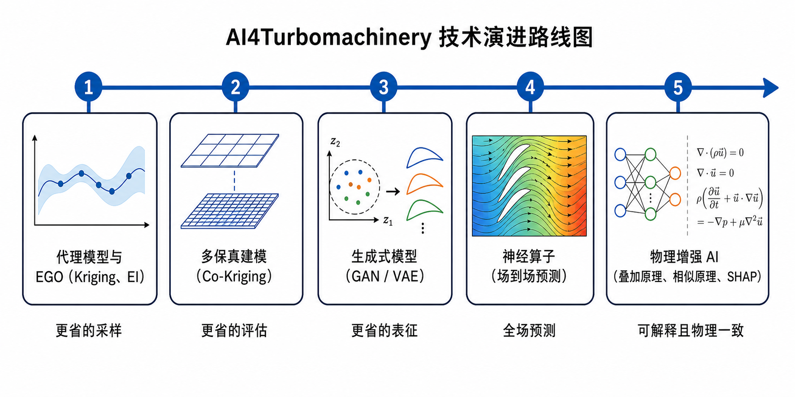

# Mr.GUO · 燃气轮机智能设计与前沿算法自学白皮书

> 郭振东老师团队 **20 篇论文（2021–2026）的全量档案**，加一本从这 20 篇里**长出来的教材级自学白皮书**——
> 从高中物理讲到顶刊前沿，每个数字都标出处，全部验收可一键复跑。



<p align="center">
  <a href="docs/重建计划.md"></a>
  <a href="tools/selftest_verifier.py"></a>
  <a href="燃气轮机智能设计与前沿算法自学白皮书.md"></a>
  <a href="code/"></a>
  <a href="BRANCH-SAFETY.md"></a>
</p>

---

## TL;DR

- **这是什么**：叶轮机械气动热力学 × 贝叶斯优化/生成式模型 × 物理增强神经算子（AI4Turbomachinery）方向的一个研究组全部 20 篇论文的整理档案，和一部按"论文里的真问题"反向写成的自学教材（白皮书）。
- **谁该读**：只学过**高数 + 线代**就想进入该方向的本科生/转行者（这是白皮书的假想读者，全书按他/她铺了四层脚手架）；以及需要引用该组成果、核对数字出处的研究者。
- **凭什么信**：三条写作铁律——**没有出处的话不写，跑不通的代码不交，对不上的数字不填**；48 项机器验收 + 30 类缺陷注入的"反身测试"证明裁判不放水（详见[如何验收](#-如何验收本仓库)）。
- **仓库怎么长成的**：`docs/重建计划.md` 是"宪法"，逐轮登记审计结论与整改；2026-09-17 完成第十九轮**分支大整合**（9 个会话分支收编为单一 `main`，实验产物归档 `archive/`，并收口分篇 PDF——18 件 / 233 页重建）。

---

## 🚀 快速开始

**只想读书**——三种形态任选：

| 形态 | 入口 | 适合 |
| :--- | :--- | :--- |
| 全书单文件 | [燃气轮机智能设计与前沿算法自学白皮书.md](./燃气轮机智能设计与前沿算法自学白皮书.md) | GitHub/编辑器里在线读，14,170 行 |
| 分篇学习版 | [分篇学习版/](./分篇学习版/)：8 个文件夹，`{篇名}-白皮书 / -检测卷合集 / -答案与评分合集` 的 md + PDF 同名 | 打印、通勤、按篇推进；**18 个 PDF / 233 页**，白皮书窄边距双栏，检测卷单栏可填答 |
| 学习工作台 | `pip install flask markdown` 后 `python3 workbench/app.py`（:5000） | 浏览器里"讲义 + 提示词卡 + 模板 + 笔记"一页循环 |

**想验证本仓库说的是不是真话**（约 2 分钟，含 pytest 真跑）：

```bash
make venv      # 建 .venv，装 numpy + pypdf + pytest
make corpus    # 从 郭老师论文/*.pdf 抽取全文语料到 corpus/txt/（版权物，不入库）
make verify    # 48 项机器验收（A–F + R），任一 FAIL 即退出码 1
make selftest  # 反身测试：把 30 类已知缺陷注入仓库，验收器必须逐项变红
```

**想动手跑算法**：[code/](./code/) 10 个模块（高斯过程 / 采集函数 / 多保真 / 分解聚合 / 迁移 / 多目标基准等）零外部依赖，仅 NumPy；`python3 code/gp.py` 即可看每个模块自带的 `--selftest` 演示。

---

## 🗺️ 学习路线图（白皮书怎么读）

全书结构：**第零章 + 六篇 + 20 讲 + 附录**。每讲固定六节：*生活与物理直觉 → 工程死穴 → 数学 → 控制流 → 验证 → 批判*（A6 逐项验收，20/20 讲齐全）。

| 篇 | 讲次 | 主题 | 对应研究方向 |
| :--- | :--- | :--- | :--- |
| 第零章 | — | 极简前置：初高中数理 → 燃气轮机；0.4 概率统计急救包、0.5 叶轮机词典 | 全书地基 |
| 第一篇 | 01–05 | 昂贵黑箱怎么"聪明地试"：CR-EI、Filter-GEI、GSDE、DA-EGO、多保真 | ① 贝叶斯优化与高维代理模型 |
| 第二篇 | 06–09 | 把形状装进小空间再搜：GMFoO、SW-VAE、GTO、VAE-NURBS 参数化 | ② 生成式模型与跨任务迁移 |
| 第三篇 | 10–15 | 让一次评估几乎免费：TNO、SDNO、P-ResUNet、SHAP、流固耦合、子午面全景 | ③ 物理增强神经算子（AI4Turbomachinery） |
| 第四篇 | 16–20 | 回到真实机器：端壁/叶尖、风洞实验、UQ、复合冷却 | ④ 流动控制、气动热与实验 |
| 第五篇 | — | 实践与代码：`code/` 逐模块精读 + `workbench` 学习流 | 工程落地 |
| 第六篇 | — | 全景对比矩阵、审稿人式横向批判、顶刊前瞻选题 | 研究判断力 |
| 附录 | — | 双语图册 + 附录 G 术语表（★分级"大二生已知/未知"） | 查阅 |

**四层脚手架**（2026-09-13 第十八轮"大二生审读整改"的产物——当时审出每讲平均 16 个没教过的词，现在按顺序用它们兜底）：

1. **第零章急救包/词典**：σ、Φ/φ、高斯过程、总压损失、三涡……最常见的 40 个词各一段人话；
2. **过桥 A–D**（`docs/bridges/`）：开讲前按主题补一节"急救包"（优化与代理 / 生成模型 / 神经网络 / 实验与 UQ）；
3. **每讲开场"前置知识检查"**：指明依赖哪几节 + 三道自检题，答不上先回去补；
4. **3B 符号卡与附录 G**：符号在哪一讲第一次教、在哪回来找你，全有指路。

**测自己**：[检测题/](./检测题/)——第零章 + 20 讲共 **21 套**（每套 100 分 / 30 分钟，卷 + 答案与评分标准分离），命题口径与正文同一套出处标注。第一遍通读请配合 [docs/reader_path_03_20.md](./docs/reader_path_03_20.md)（只学"看问题"的四件事，别在符号上死磕）。

20 讲 ↔ 20 论文对照（讲义编号按"失败模式"排序，论文编号按年份，两套编号的映射即这张表，机器核对见 D7）：

| 讲次 | 所在篇 | 讲题（方法代号与一句话） | 对应论文 |
| :---: | :--- | :--- | :---: |
| 01 | 第一篇 | CR-EI：贝叶斯优化为什么会"瞎逛"——过度探索的发现与校准 | 01 |
| 02 | 第一篇 | Filter-GEI：老专家与实习生——多保真并行优化怎样把钱花在刀刃上 | 02 |
| 03 | 第一篇 | GSDE：126 维的奇迹——为什么贝叶斯优化在高维叶栅面前必须让位 | 07 |
| 04 | 第一篇 | DA-EGO：把 126 维切成小块——动态分解与聚合如何救活贝叶斯优化 | 11 |
| 05 | 第一篇 | EMFS / MSFO：当"便宜的粗网格"开始骗人——多保真优化的暗面 | 13 |
| 06 | 第二篇 | GMFoO：一个潜空间不够，那就同时用好几个 | 06 |
| 07 | 第二篇 | SW-VAE / KT-ASO：把上一个型号的设计经验"搬"到新型号上 | 08 |
| 08 | 第二篇 | GTO：GAN 不会"反推"，那就用梯度硬算出来 | 17 |
| 09 | 第二篇 | VAE-NURBS 端壁参数化：把生成式参数化从叶型推广到非轴对称端壁 | 14 |
| 10 | 第三篇 | TNO：不优化，而是让"一次评估"变得几乎免费 | 16 |
| 11 | 第三篇 | SDNO：让网络"照着物理公式"长——把叠加原理写进神经算子 | 12 |
| 12 | 第三篇 | P-ResUNet：把"相似原理"写进输入，把"载荷分布"写进输出 | 18 |
| 13 | 第三篇 | SHAP：优化跑完之后，那一堆数据里到底藏着什么？ | 19 |
| 14 | 第三篇 | 从流体到结构：给叶片建一个"流固耦合数字孪生" | 15 |
| 15 | 第三篇 | 子午面全景预测：把"物理"写进 AI 预测模型的最后一块拼图 | 20 |
| 16 | 第四篇 | 端壁：涡轮里最热、最难冷却、也最容易被忽略的角落 | 03 |
| 17 | 第四篇 | 把端壁真的送进风洞：跨声速涡轮转子的非轴对称端壁实验 | 09 |
| 18 | 第四篇 | 叶尖：涡轮里泄漏、刮擦、换热三件事同时发生的地方 | 10 |
| 19 | 第四篇 | 图纸上挑不出毛病的设计，造出来还好用吗？——端壁气热性能的不确定性量化 | 04 |
| 20 | 第四篇 | 内外夹攻：冲击冷却 + 气膜冷却的复合冷却构型 | 05 |

---

## 📚 论文全景索引（20 篇）

元数据逐篇核过 DOI 与出版商页面（台账：[corpus/doi_verification.md](./corpus/doi_verification.md)，审计初期曾查出 3 处硬伤并已修正、立 FORBIDDEN 回归守卫）；量化断言一律回溯 [corpus/facts/](./corpus/facts/) 事实卡。本地原件在 [郭老师论文/](./郭老师论文/)：13 篇 PDF 全文 + 2 篇仅摘要级 HTML 页面（论文 09、10）；04/05/13/14/20 无本地全文，依据权威著录与出版商摘要（B 级证据）。

| 编号 | 年份 | 论文题目 | 发表期刊 / 会议 | 本地文献原件 | 核心技术要点 |
| :---: | :---: | :--- | :--- | :--- | :--- |
| **01** | 2021 | Calibrated and recalibrated expected improvements for Bayesian optimization | *Struct. Multidisc. Optim.* | `s00158-021-03038-3.pdf` | CR-EI 采集准则 / 平衡过度探索与开发 |
| **02** | 2021 | Parallel multi-fidelity expected improvement method for efficient global optimization | *Struct. Multidisc. Optim.* | `s00158-021-02931-1.pdf` | Filter-GEI 多保真度并行加点采样 |
| **03** | 2021 | Aero-thermal optimization of a gas turbine blade endwall with non-axisymmetric contouring and purge flow | *Int. J. Heat Mass Transfer* | `1-s2.0-S0017931021007298-main.pdf` | 非轴对称端壁造型 / 耦合轮缘密封冷气 |
| **04** | 2021 | Uncertainty Quantification of Aero-Thermal Performance of a Blade Endwall Considering Slot Geometry Deviation and Mainstream Fluctuation | *J. Turbomach.* (ASME) | 在线收录 | Kriging 代理模型 / 端壁气动热 UQ 分析 |
| **05** | 2021 | Effects of Cooling Configurations on the Aerothermal Performance of a Turbine Endwall With Jet Impingement and Film Cooling | *J. Turbomach.* (ASME) | 在线收录 | 冲击+气膜复合冷却构型 / ANOVA 方差分析 |
| **06** | 2023 | Generative Multiform Bayesian Optimization | *IEEE Trans. Cybernetics* | `Generative_Multiform_Bayesian_Optimization.pdf` | GMFoO 多隐空间多形式生成式优化 |
| **07** | 2023 | An efficient surrogate-assisted differential evolution algorithm for turbomachinery cascades optimization with more than 100 variables | *Aerosp. Sci. Technol.* | `1-s2.0-S1270963823005710-main.pdf` | GSDE 超百维代理差分算法 / 3.5级压气机优化 |
| **08** | 2024 | Knowledge transfer accelerated turbine blade optimization via an sample-weighted variational autoencoder | *Aerosp. Sci. Technol.* | `1-s2.0-S1270963824001317-main.pdf` | SW-VAE 样本加权自编码器 / 跨任务知识迁移 |
| **09** | 2024 | Experimental investigation on the aerodynamic performance of a transonic turbine rotor with non-axisymmetric endwall | *Aerosp. Sci. Technol.* | `S1270963824001482.htm` | 跨声速环形叶栅风洞实验 / 损失实测降低 14.0%（MA=0.8，见事实卡 P09） |
| **10** | 2024 | Aerothermal optimization of a turbine rotor tip configuration based on free-form deformation approach | *Int. J. Heat Fluid Flow* | `S0142727X24003692.htm` | FFD 自由变形 / 涡轮转子叶尖凹槽气动热优化 |
| **11** | 2024 | A dynamic aggregation strategy enhanced efficient global optimization algorithm for solving high-dimensional turbomachinery design problems | *Eng. Optimization* | `A dynamic aggregation strategy enhanced efficient global optimization algorithm for solving high-dimensional turbomachinery design problems.pdf` | DA-EGO 动态子空间分解与聚合算法 |
| **12** | 2024 | Enhancing the Generalization Ability of Endwall Film Cooling Prediction by Incorporating Superposition Principle into Transformer-based Neural Operator | *SSRN / Elsevier* | `ssrn-4869789.pdf` | SDNO 叠加深层神经算子 / 气膜小样本大外推 |
| **13** | 2024 | A Novel Multi-Fidelity Surrogate for Efficient Turbine Design Optimization | *J. Turbomach.* (ASME) | 在线收录 | DBSCAN 聚类侦测 / EMFS 局部高保真融合 |
| **14** | 2024 | Generative Model Based Parameterization for More Efficient Aerodynamic Optimization of Non-Axisymmetric Endwall | *ASME Turbo Expo* (GT2024-128792) | 会议收录 | VAE + NURBS 层 / 非轴对称端壁生成式参数化（9 变量） |
| **15** | 2025 | AI-Assisted Fluid-Structure Modeling and Optimization of Pump-Jet Propulsor | *IEEE Congr. Evol. Comput. (CEC)* | `AI-Assisted_Fluid-Structure_Modeling_and_Optimization_of_Pump-Jet_Propulsor.pdf` | 泵喷推进器流固耦合 AI 辅助多目标优化 |
| **16** | 2025 | A panoramic aerodynamic performance prediction method for turbomachinery cascades using transformer-enhanced neural operator | *Chin. J. Aeronaut.* | `1-s2.0-S1000936125000792-main.pdf` | TNO Transformer 增强神经算子 / 全景 N-S 场预测 |
| **17** | 2026 | Generative Transfer Optimization for More Efficient Turbine Blade Design | *Aerosp. Sci. Technol.* | `1-s2.0-S1270963826007042-main.pdf` | GTO 生成对抗网络 (GAN) / 梯度重参数化迁移 |
| **18** | 2026 | Physics-enhanced performance prediction and intelligent design for wide-operating-range turbine blades | *Aerosp. Sci. Technol.* | `1-s2.0-S1270963826007315-main.pdf` | 流动相似原理 / ResUNet 宽工况智能设计 |
| **19** | 2026 | SHAP-based data mining for high-dimensional design space of high-pressure turbine stage | *Chin. J. Aeronaut.* | `1-s2.0-S1000936126003122-main.pdf` | GE-E3 高压透平级 93维设计空间 SHAP 特征归因 |
| **20** | 2026 | Physics-enhanced AI model for panoramic prediction of the meridional performance of turbomachinery cascades | *Proc. SPIE* 14253 (HARCT 2026) | 会议收录 | 物理增强 Transformer 神经算子 / 高压涡轮级子午面全景预测 |

> **四份专题文档**：[郭老师论文全集综合整理汇总.md](./郭老师论文全集综合整理汇总.md)（20 篇逐篇解析 + 知识图谱）、[公开论文整理.md](./公开论文整理.md)（15 篇公开全文）、[付费论文五篇整理.md](./付费论文五篇整理.md)（ASME/SPIE 五篇）、[论文链接整理.md](./论文链接整理.md)（DOI 与检索入口）。
> **非团队论文**：同领域检索中确认*不属于*本团队的 9 篇，已排除并留负例证据（`archive/from_01a00377/excluded-non-team-papers.json`），防止混入上表。

---

## ✅ 如何验收本仓库

验收标准写在 [docs/重建计划.md](./docs/重建计划.md)（"宪法"），机器可验部分由 [tools/verify_all.py](./tools/verify_all.py) 判定，**当前状态：48/48 PASS**。分组如下：

| 组 | 项数 | 管什么（节选） |
| :--- | :---: | :--- |
| A 内容 | 9 | 20 讲齐全、每讲六节结构、无出处数字清零（A5）、无源形容词（A7）、算式复算（A8）、公式必须预览可读：禁 `$`/裸 LaTeX，全 Unicode（A9） |
| B 代码 | 7 | `code/` 10 模块语法/依赖/自检，**真跑** 129 用例 + 37 子测试，白皮书内嵌代码与源一致 |
| C 配图 | 5 | 212 张中文教学图：零死链（C1）、零孤儿（C2）、图文相符（C3）、四篇主体各有图、每讲 ≥10 图（C5） |
| D 口径 | 11 | 01–20 编号全仓贯穿；README 索引表 20/20；讲↔文映射一致（D7）；五份索引文档的 % 断言全部可溯（D8）；已裁定的错误串**不得复现**（FORBIDDEN 回归守卫） |
| E 技能包 | 4 | `skills/omni_scholar/` 可运行、演示命令真跑 |
| F 交付物 | 6 | 20 张事实卡栏目齐、白皮书与源**逐字节一致**（F4，源内容哈希戳防手改）、事实卡"逐字摘要"与语料逐字比对（F5） |
| R 可读性 | 4 | 大二生专项：无占位回译 / 无乱码公式 / 符号卡备注指路齐 / 前置知识块在位 |

> **为什么有 `make selftest`**：本仓库曾出现过"验收器 18/18 全绿、实际大量不达标"的事故——裁判比标准宽松。
> 现在 30 类已知缺陷会被逐一注回仓库并断言验收器**必须亮红灯**（[tools/selftest_verifier.py](./tools/selftest_verifier.py)），
> 还原后再断言 48/48。**验收结论的可信度来自这里。**

---

## 🧭 仓库地图

```text
Mr.GUO/
├── 燃气轮机智能设计与前沿算法自学白皮书.md        # 派生物总入口：docs/ + code/ 装配而成，勿手改
├── 分篇学习版/                                    # 8 篇 × {白皮书|检测卷合集|答案与评分合集}，md+PDF 同名（18 PDF / 233 页）
├── 检测题/                                        # 21 套卷子 + 答案与评分标准（分篇学习版的命题源）
├── docs/                                          # 白皮书源文件（改这里 → make whitepaper）
│   ├── front_matter.md / chapter0.md / part6.md    # 前言 / 第零章 / 第六篇
│   ├── lectures/01–20.md                           # 20 讲讲稿（每讲六节 + 前置检查块 + 符号卡）
│   ├── bridges/bridge_A–D.md                       # 过桥急救包（优化 / 生成模型 / 神经网络 / 实验与UQ）
│   ├── glossary.md                                 # 附录 G 术语表（★分级 + 在哪教过）
│   ├── reader_path_03_20.md                        # 第一遍阅读主路（别逐字啃深读段）
│   ├── pedagogy/ projects/ learning_os.md           # 教学法模板 / 结业项目 / 学习操作系统
│   └── 重建计划.md                                  # ★宪法：验收标准 + 十九轮整改台账
├── corpus/                                        # 事实底座：20 张事实卡 / DOI 核查台账 / 5 份 web 补证 / R01 相关文献
├── 郭老师论文/                                     # 15 个论文原件文件（13 PDF + 2 摘要级 HTML）
├── 公开论文整理.md / 付费论文五篇整理.md            # 15 + 5 篇专题整理
├── 郭老师论文全集综合整理汇总.md / 论文链接整理.md   # 全集总览 / DOI 检索索引
├── code/ · tests/                                  # NumPy-only 算法原型（10 模块）+ 129 用例
├── images/                                        # 212 张中文教学图（每讲 ≥10 张）
├── prompts/ · templates/ · workbench/              # 8 阶段 × 逐讲提示词卡 / 5 类学习模板 / Flask 工作台
├── skills/omni_scholar/                            # 文献核验技能包（--demo 可跑）
├── tools/                                          # 装配/验收/分篇 PDF 工具链（见下）
├── archive/                                        # 历史会话分支的吸收档案（身份卡 + 台账，见下）
├── BRANCH-SAFETY.md                               # ★AI 协作者必读：分支安全与快进推送手册
└── Makefile                                       # venv / corpus / whitepaper / checks / verify / selftest
```

**白皮书是派生物**：`docs/` 与 `code/` 任何改动后必须 `make whitepaper`，否则 F4 红——白皮书头部 `src-<12位哈希>` 为源内容戳，源不变则产物逐字节不变。分篇 PDF 构建链（含字体搭建）见 [tools/pdf_build/README.md](./tools/pdf_build/README.md)。

---

## 🤝 协作与仓库纪律

- **AI agent 动手前必读** [BRANCH-SAFETY.md](./BRANCH-SAFETY.md)：五条铁律 + 快进推送上 `main` 的完整流程（本仓库历史由多个 agent 会话接力写成，这是防踩坑手册）。
- **分支纪律（2026-09-17 起）**：会话分支只作施工场所；**一切内容汇入 `main`**，实验产物按前例归入 `archive/` 并附身份卡——`from_01a00377`（论文摘要线，16 篇摘要 + 排除清单 + 技能 catalog 索引）、`from_01a07526`（会话传输补丁存证）、`from_01a098ab`（第零章B方案 + 模拟读者审计器）、`from_01a099ed`（可达性审计器 + 补丁册方案）。被吸收分支的历史经 merge 父在 `git log` 中永久可达。
- **改讲义的正确姿势**：数字只从 `corpus/facts/` 取；引用出处写成 `［原文 P07 §4.2］` 样式；公式用 Unicode；改完 `make verify && make selftest` 两个全绿再交。
- **当前无开源许可证**：文档与数据的权利归属作者及其团队；论文内容请引用原始出处（DOI 均见上表），`code/` 若需再分发请先与维护者沟通。

## 🔗 作者与检索入口

- **Google Scholar:** [Zhendong Guo (郭振东)](https://scholar.google.co.jp/citations?user=zj4KM6cAAAAJ&hl=en)
- **ResearchGate:** [Zhendong Guo](https://www.researchgate.net/profile/Zhendong-Guo-3)
- 研究主线备忘与领域综述：`archive/from_01a00377/AI_TURBOMACHINERY_STRATEGIC_MEMORY.md`（已自标"待核验"，引用前请复核）

<sub>仓库演进逐轮记录见 <a href="docs/重建计划.md">docs/重建计划.md</a>；本 README 中的一切数字（48/48、30/30、14,170 行、233 页、212 图、21 套）在发布时均可用「快速开始」中的命令复现。</sub>
